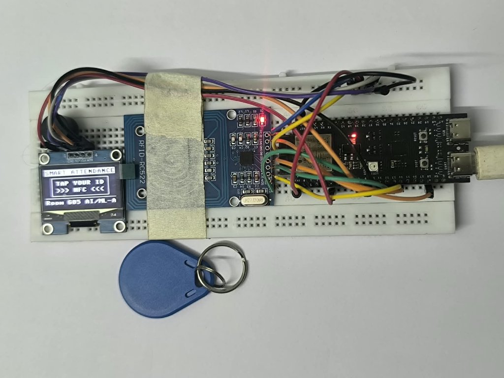

# SNSAS - Smart NFC Student Attendance System

[](https://micropython.org/)
[](https://www.espressif.com/en/products/socs/esp32-s3)
[](https://supabase.com/)
[](https://sheets.google.com/)
[](LICENSE)

An open-source, production-grade IoT student attendance terminal built with the **ESP32-S3**, **SSD1306 128x64 I2C OLED**, **RC522 13.56MHz RFID Reader**, **Active Buzzer**, **Supabase (PostgreSQL RPC)**, and real-time **Google Sheets** synchronization.



---

## 🚀 Key Features

* **Sub-10ms Edge Caching**:
  * Scanned cards are verified against an in-memory roster cache (`STUDENTS_CACHE`) in **`< 5 milliseconds`**—zero cloud wait times for students.
* **100% Offline Capability**:
  * The student roster is persisted on the ESP32 onboard flash (`students_cache.json`).
  * If the campus Wi-Fi router is powered off, students are **still marked `PRESENT` instantly**. Scans are queued locally (`offline_queue.json`) and automatically uploaded once Wi-Fi reconnects.
* **Automatic Two-Way Cloud Sync**:
  * On power-on, the terminal automatically pulls active enrolled students from Supabase.
  * If an attendance record or student is deleted in the web dashboard/database, the terminal automatically purges it on its next periodic sync cycle (every 15 seconds), allowing the student to scan again without requiring a reboot.
* **Instant Duplicate Prevention (Idempotent)**:
  * Tapping a card twice in the same day triggers an instant **`ALREADY MARKED`** screen and single warning tone in 0ms without hitting the cloud.
* **Accurate Indian Standard Time (IST, UTC+5:30)**:
  * Bypasses firewall-blocked UDP port 123 (NTP) by reading Google's HTTP `Date:` header on port 80 (`clients3.google.com`), synchronizing the hardware RTC in under 200ms on all mobile hotspots and campus firewalls.
* **Rock-Solid Wi-Fi RF Stability**:
  * Configured with `wlan.PM_NONE` (modem power-save disabled, continuous 20 dBm transmission) with a debounced 3-strike watchdog to prevent hotspot flapping.
* **Zero-Cloud-Cost Google Sheets Register**:
  * Native Google Apps Script webhook integration syncs records directly into a formatted Google Sheet with status badges, timestamps, and manual/auto clean pull options.

---

## 📐 System Architecture

```
                                  [ RFID Card (13.56 MHz) ]
                                             │
                                             ▼
                             +───────────────────────────────+
                             │     ESP32-S3 DevKit Board     │
                             │  - Sub-10ms In-Memory Cache   │
                             │  - Offline Flash Backup Queue │
                             │  - SSD1306 OLED + Buzzer      │
                             +───────────────┬───────────────+
                                             │
                                             │ HTTPS POST (RPC)
                                             ▼
                             +───────────────────────────────+
                             │    Supabase Cloud Database    │
                             │  - PostgreSQL Atomic RPC      │
                             │  - Row-Level Security (RLS)   │
                             │  - Webhook Trigger            │
                             +───────────────┬───────────────+
                                             │
                                             │ Webhook Push (JSON)
                                             ▼
                             +───────────────────────────────+
                             │   Google Apps Script Webhook  │
                             │   "Smart Attendance Register" │
                             │  - 1-Click Clean Sync Now     │
                             │  - Real-Time Live Row Append  │
                             +───────────────────────────────+
```

---

## 🛠️ Hardware Bill of Materials (BOM)

| Component | Specification | Quantity | Est. Cost (INR) |
| :--- | :--- | :---: | :---: |
| **Microcontroller** | ESP32-S3 DevKit (4MB/8MB Flash, Dual USB-C) | 1 | ~₹380 |
| **Display** | SSD1306 / SH1106 0.96" 128x64 I2C OLED (4-pin) | 1 | ~₹160 |
| **RFID Reader** | MFRC522 (RC522) 13.56 MHz SPI Reader | 1 | ~₹110 |
| **RFID Cards / Fobs** | ISO/IEC 14443A Mifare Classic 1K (Keyfob / Card) | 2+ | ~₹15 each |
| **Buzzer** | 3.3V / 5V Active Piezo Buzzer | 1 | ~₹20 |
| **Breadboard & Wires**| Half-size Breadboard + Dupont Jumper Wires | 1 | ~₹100 |
| **Total BOM** | Complete functional attendance terminal | — | **~₹785** (~$9.50) |

---

## 🔌 Pin Connections

Detailed wiring diagrams and pinouts are in [docs/wiring_diagram.md](docs/wiring_diagram.md).

| Module | Pin Label | ESP32-S3 GPIO | Notes |
| :--- | :--- | :--- | :--- |
| **SSD1306 OLED (I2C)** | GND | GND | Common Ground |
| | VCC | 3.3V | Power Supply (3.3V) |
| | CLK (SCL) | **GPIO 9** | I2C Clock (400kHz fast bus) |
| | MOCI (SDA) | **GPIO 10** | I2C Data |
| **MFRC522 RFID (SPI)** | 3.3V | 3.3V | ⚠️ *Do NOT connect to 5V!* |
| | RST | **GPIO 18** | RFID Reset |
| | GND | GND | Common Ground |
| | MISO | **GPIO 13** | Dedicated SPI2 MISO |
| | MOSI | **GPIO 11** | Dedicated SPI2 MOSI |
| | SCK | **GPIO 12** | Dedicated SPI2 SCK (1 MHz) |
| | SDA (CS / SS) | **GPIO 8** | RFID Chip Select |
| **Active Buzzer** | Signal (+) | **GPIO 4** | Active Tone Signal |
| | GND (-) | GND | Common Ground |

---

## ⚡ Quickstart Guide

### 1. Database Setup (Supabase)
1. Create a free project at [supabase.com](https://supabase.com).
2. Go to **SQL Editor** (`>_`) in your Supabase Dashboard.
3. Run the schema script: [`database/01_schema.sql`](database/01_schema.sql).
4. Run the atomic stored procedure script: [`database/02_attendance_rpc.sql`](database/02_attendance_rpc.sql).
5. Copy your **Project URL** and **anon public key** from *Project Settings -> API*.

### 2. Google Sheets Setup
1. Create a new Google Sheet at [sheets.new](https://sheets.new).
2. Go to **Extensions -> Apps Script**.
3. Replace the contents with [`google_sheets/Code.gs`](google_sheets/Code.gs).
4. Fill in your `SUPABASE_URL` and `SUPABASE_ANON_KEY` at the top of the script.
5. Click **Deploy -> New deployment -> Web app** (Access: *Anyone*).
6. Copy the Webhook URL and add it to your Supabase Database Webhook settings (or use the sheet's built-in **🎓 Smart Attendance -> ⚡ Clean Sync Now** menu button).

### 3. Flash Firmware to ESP32-S3
1. Install `esptool` and `mpremote`:
   ```bash
   pip install esptool mpremote
   ```
2. Download official MicroPython firmware for ESP32-S3 from [micropython.org](https://micropython.org/download/ESP32_GENERIC_S3/).
3. Erase and flash:
   ```bash
   esptool.py --chip esp32s3 --port COM6 erase_flash
   esptool.py --chip esp32s3 --port COM6 write_flash -z 0 ESP32_GENERIC_S3.bin
   ```
4. Copy the firmware files to the ESP32:
   ```bash
   cd firmware_micropython
   mpremote connect COM6 fs cp config.py :config.py
   mpremote connect COM6 fs cp buzzer.py :buzzer.py
   mpremote connect COM6 fs cp ssd1306.py :ssd1306.py
   mpremote connect COM6 fs cp mfrc522.py :mfrc522.py
   mpremote connect COM6 fs cp portal.py :portal.py
   mpremote connect COM6 fs cp students_cache.json :students_cache.json
   mpremote connect COM6 fs cp main.py :main.py
   ```
5. Reset the board:
   ```bash
   mpremote connect COM6 reset
   ```

---

## 🔒 Open Source & Security Best Practices

* **No Hardcoded Secrets**: The repository contains only templates. Wi-Fi credentials and Supabase API keys are loaded dynamically or configured via `config.py` on the device.
* **Safe Sharing**: If preparing your own public repository from this codebase, ensure you start with a clean git history so that no previous test API keys or local passwords remain in the commit history.

---

## 👥 Team & Contributors

Made with ❤️ by:

| [<br /><sub><b>Jnyananjan Sarkar</b></sub>](https://github.com/Jnyananjan) | [<br /><sub><b>Sujoy Bhowmik</b></sub>](https://github.com/bhowmiksujoy812-ai) | [<br /><sub><b>Iman Kalyan Dey</b></sub>](https://github.com/imankdey-cpu) | [<br /><sub><b>Aindreela</b></sub>](https://github.com/aindreela05-sys) |
| :---: | :---: | :---: | :---: |

---

## 📄 License

This project is licensed under the [MIT License](LICENSE).
