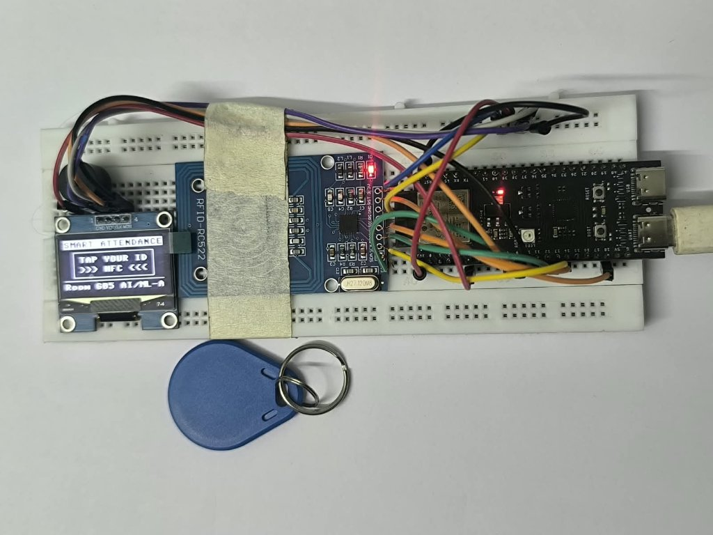

# Hardware Wiring Diagram (ESP32-S3 + SSD1306 OLED + MFRC522 + Buzzer)

---

## 1. Production Pinout Table

The terminal uses a dedicated **SPI2 bus for the RC522 RFID reader** and hardware **I2C(0) for the SSD1306 128x64 OLED display**. This separation prevents SPI/I2C bus contention and ensures ultra-low latency.

| Peripheral | Board Pin Label | ESP32-S3 Pin | Function | Notes |
| :--- | :--- | :--- | :--- | :--- |
| **SSD1306 OLED (I2C)** | **GND** | **GND** | Ground | Common Ground |
| | **VCC** | **3.3V** | Power | Power (3.3V) |
| | **CLK (SCL)** | **GPIO 9** | I2C Clock | 400 kHz fast I2C bus |
| | **MOCI (MOSI / SDA)** | **GPIO 10** | I2C Data | Hardware I2C SDA |
| **MFRC522 RFID (SPI)** | **3.3V (VCC)** | **3.3V** | Power | ⚠️ *Do NOT connect to 5V!* |
| | **RST** | **GPIO 18** | Reset | Dedicated RFID Reset |
| | **GND** | **GND** | Ground | Common Ground |
| | **IRQ** | *Unconnected*| Interrupt | Not used |
| | **MISO** | **GPIO 13** | SPI MISO | Dedicated SPI2 Data In |
| | **MOSI** | **GPIO 11** | SPI MOSI | Dedicated SPI2 Data Out |
| | **SCK** | **GPIO 12** | SPI Clock | 1 MHz SPI Clock |
| | **SDA (SS / CS)** | **GPIO 8** | Chip Select | Dedicated RFID CS |
| **Active Buzzer** | **+ (Signal)** | **GPIO 4** | Signal | Active Piezo Buzzer control |
| | **- (GND)** | **GND** | Ground | Common Ground |

---

## 2. Power Supply Recommendations

* Power the ESP32-S3 via a standard 5V 1A USB-C wall charger or power bank.
* The onboard 3.3V LDO regulator on the ESP32-S3 DevKit comfortably powers the SSD1306 OLED (~15-20mA), the MFRC522 RFID reader (~13-26mA), and the active buzzer (~25mA).
* **Warning**: Always connect the MFRC522 VCC pin to **3.3V**. Connecting to 5V will permanently burn the MFRC522 CMOS transceiver.
